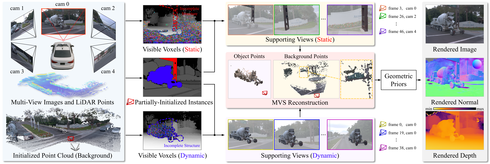

# [CVPR 2026] VAD-GS: Visibility-Aware Densification for 3D Gaussian Splatting in Dynamic Urban Scenes
[Project page](https://mias.group/VAD-GS/) |  [Paper](https://arxiv.org/abs/2510.09364) | [Youtube](https://www.youtube.com/watch?v=vq7EhjpogY0) | [Bilibili](https://www.bilibili.com/video/BV131P5zXESN)

<div class="alert alert-info">
<p align="center">
  
</p>
</div>

### Installation
<details> <summary>Clone this repository and checkout dev branch</summary>

```
git clone https://github.com/YikangZhang1641/VAD-GS.git
git checkout -b dev origin/dev
```
</details>


<details>
<summary>Build tools</summary>

1. Install [COLMAP](https://colmap.github.io/install.html) (tested version 3.10-dev)
2. Build SIBR_viewer following the tutorial of [3DGS](https://github.com/graphdeco-inria/gaussian-splatting)

</details>


<details> <summary>Set up the environment</summary>

```
# Set conda environment
conda create -n vadgs python=3.8
conda activate vadgs

# Install torch (corresponding to your CUDA version)
pip install torch==1.12.0+cu113 torchvision==0.13.0+cu113 torchaudio==0.12.0 --extra-index-url https://download.pytorch.org/whl/cu113

# Install requirements
pip install -r requirements.txt

# Install submodules
pip install ./submodules/diff-gaussian-rasterization
pip install ./submodules/simple-knn
pip install ./submodules/simple-waymo-open-dataset-reader
pip install ./submodules/MyPropagation
```
</details>


### Datasets 

```
data/
   ├── nuscenes/
   │     ├── raw/
   │     ├── processed_10Hz/
   │     │     ├── mini/
   │     │     │     ├── 000/
   │     │     │     │     ├── images/
   │     |     │     │     ├── ego_pose/
   │     |     │     │     ├── lidar_depth/
   │     |     │     │     └── ...
   │     │     │     ├── 001/
   │     │     │     ├── ...
   └── waymo/
         |...
   ```


### Example 
- Our data processing follows [StreetGaussians](https://github.com/zju3dv/street_gaussians)(Waymo) and [DriveStudio](https://github.com/ziyc/drivestudio)(nuScenes). Other initial guesses are predicted via [DA v2](https://github.com/DepthAnything/Depth-Anything-V2), [DSINE](https://github.com/baegwangbin/DSINE) and [SAM](https://github.com/facebookresearch/segment-anything). 
More details can be found in notebooks.
- We also provide examples [here](https://drive.google.com/drive/folders/1zIrNXwiNq1szcktI8So8GDUGVhhJRn07?usp=drive_link). Download and extract it to the folder path above.

For training:
```
python train.py --config configs/example/nuscenes_train_000.yaml
```

Optional offline VGGT-Omega pixel visibility (VADT `98540b1`): place a compact
`predictions.npz` in the scene's `source_path`, or set `data.vggt_predictions` to
an absolute path or a path relative to `source_path`. An empty value disables
loading; a missing file leaves the lookup unavailable. Waymo and DriveStudio
readers load the pixel-to-voxel map into camera guidance and the voxel-to-view
table into `dataset.scene_info.metadata["vggt_voxel_info"]`, independently of
initial point-cloud generation. Existing point-cloud caches need no rebuild.
The lookup requires neither LiDAR/COLMAP points nor online VGGT inference:

```python
from lib.datasets.vggt_prediction_io import get_vggt_pixel_source_views

camera = viewpoint_full_stack[view_id]
view_ids = get_vggt_pixel_source_views(
    camera, dataset.scene_info.metadata["vggt_voxel_info"], u=100, v=200,
)
```

Pixels use the current camera image resolution; crop, resize and padding are
handled when loading camera guidance. Invalid pixels return an empty array.
Returned IDs index the selected scene views (frame + camera, including any test
views); filter to training views if needed. They represent views contributing to
the same VGGT pseudo-voxel, with accuracy limited by voxel size. VGGT coordinates
remain in their own scale and do not initialize or modify the scene point cloud.

To generate this cache offline, use the migrated VADT generator with an
experiment configuration plus `data.vggt_prediction_generation` settings.
Two preprocessing configurations inherit the training examples, so their
`source_path`, selected frames and cameras stay aligned:

```bash
# From the VAD-GS repository root; validate inputs without loading the model.
python script/generate_vggt_visibility.py --config configs/preprocess/vggt_waymo_train_021.yaml --dry-run

# Run once in the existing VGGT-Omega inference environment.
conda run -n playground python script/generate_vggt_visibility.py --config configs/preprocess/vggt_waymo_train_021.yaml
conda run -n playground python script/generate_vggt_visibility.py --config configs/preprocess/vggt_nuscenes_train_000.yaml
```

Set `vggt_root` and `checkpoint` under `data.vggt_prediction_generation` for a
different installation. Generation uses only this offline configuration and
does not start an online worker. It requires images and binary sky masks
(`sky_mask/` or `sky_masks/`, nonzero means sky), and writes the path specified
by `data.vggt_predictions` (default: `source_path/predictions.npz`). Existing
caches require `--overwrite` to replace. Visualization is disabled by default;
set `visualize: true` for an Open3D preview. `relative_voxel_size` is measured
relative to the median valid VGGT depth, matching VADT's current exporter.

To generate visual outputs:
```
python render.py --config configs/example/nuscenes_train_000.yaml mode evaluate
```

For evaluation:
```
python metrics.py --config configs/example/nuscenes_train_000.yaml
```


### Citation

If you find this code useful for your research, please use the following BibTeX entry.

```
@inproceedings{zhang2025vadgs,
    title={VAD-GS: Visibility-Aware Densification for 3D Gaussian Splatting in Dynamic Urban Scenes}, 
    author={Yikang Zhang and Rui Fan},
    booktitle={Proceedings of the IEEE/CVF Conference on Computer Vision and Pattern Recognition (CVPR)},
    pages={},
    year={2026}
}
```
